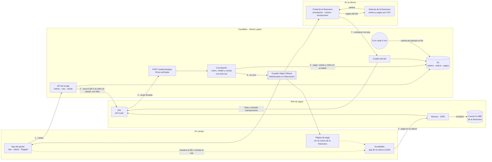

<p align="center">
  
</p>

<p align="center"><b>Que todo cuadre.</b><br>
Cobranza con CoDi para financieras: el gestor cobra en campo sin efectivo y cada pago se concilia solo.</p>

<p align="center">
  <a href="https://qadra.victormlaralopez.workers.dev"><b>Demo en vivo</b></a> ·
  <a href="https://qadra.victormlaralopez.workers.dev/gestor/">App del gestor</a> ·
  <a href="https://qadra.victormlaralopez.workers.dev/portal/">Portal de la financiera</a> ·
  <a href="#pruébalo">Pruébalo</a> ·
  <a href="#cómo-funciona-por-dentro">Diagrama</a> ·
  Hackatón México 2026
</p>

| Estado | |
|---|---|
| Software | Desplegado en Cloudflare (Worker, D1, Durable Object y cron). 103 pruebas unitarias y 31 de punta a punta en verde |
| Demo pública | Funcionando en **modo simulación**: recorre el camino completo (cobro, aviso firmado, conciliación y cuadre) con pagos de mentira, rotulados como simulados |
| Pagos CoDi reales | **Pendiente.** Las bases piden una API key de pey por proyecto y la de Qadra aún no se configura. El código del cobro real está escrito contra la versión 2026-10-20 del API y pasa a cobros reales al configurar la llave, pero **todavía no se ha probado con un pago real** |
| Cartera | Ficticia. "Financiera Jacaranda", sus créditos y sus acreditados son inventados para la demo |

---

## Qué es

Una financiera que presta a personas (microcrédito, crédito de consumo, empeño) vive cuatro problemas al cobrar:

- **Cobrar cuesta.** Cada pago en tienda o por transferencia referenciada lleva una comisión.
- **Conciliar es manual.** Llegan transferencias a una cuenta general y alguien identifica en Excel quién pagó.
- **El efectivo en la calle es riesgo.** Robos, dinero que no se deposita a tiempo y recibos de papel.
- **La mora temprana se atiende tarde.** El gestor no sabe en el momento si el cliente ya pagó.

**Qadra** es un módulo de cobranza que se pone encima del sistema que la financiera ya tiene:

1. **El gestor abre su ruta del día** en el celular y entra al crédito que va a cobrar.
2. **Genera el cobro con CoDi**: un QR en su pantalla o una solicitud de cobro al celular del acreditado. También
   puede mandarle un link de pago con la marca de la financiera.
3. **El acreditado paga desde la app de su banco**, sin comisión. El dinero va por SPEI directo a la cuenta de la
   financiera: ni el gestor ni Qadra lo tocan.
4. **En segundos el gestor ve "Pagado"** y el pago ya está aplicado a la cuota correcta. En la oficina, el corte del
   día cuadra solo.

**Para la financiera** hay un portal con la cobranza del día en vivo, la conciliación, las excepciones (pagos sin
referencia o de más) que se asignan con dos clics, la cartera y la carga por archivo CSV.

**Cómo se concilia.** Cada cobro lleva un folio de 7 dígitos que viaja a Banxico como `numRef` y regresa en el aviso
de pago, junto con el identificador del QR y el del cobro en la metadata. Con cualquiera de los tres Qadra sabe de qué
crédito es el pago y lo reparte entre sus cuotas, de la más antigua a la más reciente. Un pago se aplica **una sola
vez**, aunque el aviso se repita, y una cuota nunca queda pagada de más aunque lleguen dos pagos al mismo tiempo.

**Cuadre contra pey.** Qadra pide a pey las transacciones del día y las compara con lo que registró. Si pey cobró algo
que Qadra no tiene, el aviso se perdió: el portal lo muestra y lo recupera consultando la transacción.

**Por qué CoDi y pey.** CoDi no cobra comisión, está en la app de todos los bancos y el dinero llega en segundos con
su clave de rastreo. El API de pey da lo que hace falta para cobrar y conciliar: crear el cobro con una referencia
propia, recibir el aviso firmado y consultar las transacciones.

## Uso del API de pey

| Endpoint o evento | Qué hace en Qadra | Archivo |
|---|---|---|
| `POST /codi/qr` | Crea el QR de cada cobro (vigencia de 10 minutos, `numRef` con el folio y metadata con el cobro y el crédito) y el QR fijo de un crédito (`expiration: 0`), que acepta muchos pagos | [src/worker/pey.ts](src/worker/pey.ts), [src/worker/cobros.ts](src/worker/cobros.ts) |
| `POST /codi/pn` | Manda la solicitud de cobro a la app bancaria del acreditado, con el mismo folio. Del celular solo se guardan los últimos 4 dígitos | [src/worker/pey.ts](src/worker/pey.ts) |
| Webhooks `codi.qr.payment_received` y `codi.pn.payment_received` | Avisan cada pago. Se verifica la firma (Standard Webhooks), se identifica el cobro y se guardan el pago, sus aplicaciones a cuotas y el cierre del cobro en un solo batch | [src/worker/webhook.ts](src/worker/webhook.ts), [src/worker/conciliar.ts](src/worker/conciliar.ts), [src/core/firma.ts](src/core/firma.ts) |
| `GET /transaction/api-key` | Lista lo que pey cobró hoy para compararlo con lo registrado: el cuadre del día | [src/worker/tableros.ts](src/worker/tableros.ts), [src/core/conciliacion.ts](src/core/conciliacion.ts) |
| `GET /transaction/{id}` | Recupera un pago cuyo aviso no llegó y lo concilia por el mismo camino que un aviso | [src/worker/app.ts](src/worker/app.ts) |

## Cómo funciona por dentro

Un solo diagrama con las tres pantallas, la red de pagos y el servicio. Los números siguen el recorrido de un pago.



**Qué pasa en cada paso**

1. **Cobrar.** El gestor elige el monto y el medio. El Worker valida el cobro (monto, saldo del crédito, límites de
   uso) y lo guarda como pendiente con su folio **antes** de llamar a pey.
2. **Crear el cobro en pey.** `POST /codi/qr` o `POST /codi/pn` con el folio como `numRef`. Si pey rechaza el cobro,
   se borra; si pey no responde, se conserva: si el acreditado llega a pagar, el aviso trae el folio y el pago se
   concilia igual.
3. **Pagar.** El acreditado autoriza en la app de su banco. El dinero llega por SPEI a la cuenta de la financiera.
4. **Aviso.** pey manda el aviso firmado. El Worker lee el cuerpo con tope de tamaño, verifica la firma y la fecha,
   y convierte el monto a centavos con una sola regla.
5. **Conciliar.** Se identifica el cobro (IDC del QR o transacción del push, luego metadata, luego folio) y el pago se
   reparte entre las cuotas. Todo se escribe junto: si otro pago ganó la misma cuota, la base rechaza el batch y se
   vuelve a calcular. Lo que no se puede identificar o sobra queda como **excepción**, nunca se pierde.
6. **En vivo.** El Durable Object avisa por WebSocket a la app del gestor, al portal y a la página de pago. Si el
   canal se cae, las pantallas consultan cada pocos segundos.
7. **Cuadre.** El portal compara contra `GET /transaction/api-key`. Un pago que solo tiene pey se recupera con
   `GET /transaction/{id}`.

## Pruébalo

### En línea

La demo está en **modo simulación** mientras se configura la API key de pey del proyecto: todo lo que se cobra es de
mentira y se rotula como simulado, pero recorre el mismo camino que un pago real, incluido un aviso firmado que entra
por `/webhooks/pey`.

1. **Demo de la landing.** Abre <https://qadra.victormlaralopez.workers.dev>, presiona **Cobrar $0.01 con CoDi** en el
   teléfono y luego **Simular el pago**. Verás "Pagado" y el pago aparece en "Conciliación en vivo".
2. **App del gestor.** Abre <https://qadra.victormlaralopez.workers.dev/gestor/> y entra con **Entrar a la demo**
   (clave `demo`). Abre un crédito de la ruta, toca **Cobrar con CoDi**, genera el cobro y simula el pago. Prueba
   también **Registrar visita** con una promesa de pago, y **Enviar link de pago** para ver la página que recibe el
   acreditado.
3. **Portal de la financiera.** Abre <https://qadra.victormlaralopez.workers.dev/portal/> con la misma clave. Deja el
   portal abierto mientras cobras en la app del gestor: el pago llega en vivo. En **Conciliación** prueba:
   - **Simular un aviso de pago que se pierde** y después **Comparar con pey**: el cuadre dice "No cuadra", muestra el
     pago que falta y **Recuperar** lo trae y lo aplica.
   - **Simular transferencia sin referencia**: queda por revisar y se asigna a un crédito con **Asignar**.
4. **Cartera por archivo.** En **Integración** descarga la plantilla, cámbiale algo y súbela: verás la validación con
   renglón y columna de cada error.

La cartera de ejemplo se regenera cada día y los pagos de los otros gestores a lo largo del día son datos de ejemplo.

### En tu computadora (3 minutos)

Requisitos: Node.js 22.18 o más reciente.

```bash
git clone https://github.com/VictorLaraL/qadra.git
cd qadra
npm install
cp .dev.vars.example .dev.vars    # sin PEY_API_KEY: modo simulación
npm run dev                        # http://localhost:8790
```

- **Landing:** <http://localhost:8790>. El botón de simular manda un aviso **firmado** al mismo `/webhooks/pey` que usa
  pey.
- **App del gestor y portal:** <http://localhost:8790/gestor/> y <http://localhost:8790/portal/> con las claves
  `JURADO_TOKEN` o `PORTAL_TOKEN` de tu `.dev.vars`. Con `PORTAL_TOKEN` además puedes importar una cartera, crear el QR
  fijo de un crédito y reiniciar la demo.
- **Un pago desde la terminal:** `npm run simular:pago -- --folio <folio del cobro> --monto 450` manda un aviso firmado
  como los de pey.
- **Pruebas:**

```bash
npm test          # 103 pruebas unitarias: firma, lectura del aviso, conciliación, CSV, fechas, cobros, validaciones y reglas del navegador
npm run e2e       # 31 pruebas de punta a punta contra npm run dev (en otra terminal)
npm run typecheck # tipos de TypeScript contra los bindings de Cloudflare
```

Las pruebas de punta a punta cubren, entre otras cosas: avisos sin firma rechazados, un pago que llega dos veces y se
aplica una, tres pagos simultáneos al mismo crédito sin pagar de más ninguna cuota, pagos de más y sin referencia como
excepciones, el aviso perdido que el cuadre detecta y recupera, los límites de cobros al celular, el canal en vivo con
boleto, la página de pago sin datos del acreditado y la carga de cartera por CSV.

## Seguridad y reglas de cobro

| Riesgo | Cómo se cubre |
|---|---|
| Avisos de pago falsos | Firma HMAC-SHA256 de Standard Webhooks con comparación en tiempo constante; ventana de 5 minutos; el cuerpo se lee con tope de 64 KB, venga o no `Content-Length` |
| Aplicar dos veces un pago | `transactionId` como llave única en un libro que sobrevive a los reinicios; pago, aplicaciones y cierre del cobro en un solo batch de D1 |
| Pagar de más una cuota | Restricción en la base (`pagado <= monto`): si dos pagos compiten, el segundo falla completo y se recalcula |
| Dinero que no se puede identificar | Queda como excepción con su clave de rastreo y se asigna a un crédito desde el portal; el sobrante de un pago de más también |
| Aviso de pago que nunca llega | El cuadre contra pey lo detecta y lo recupera consultando la transacción |
| Cobro creado en pey sin registro | El cobro se guarda antes de llamar a pey; si pey no responde, se conserva para conciliar un pago tardío |
| El gestor desvía el dinero | El gestor no cobra efectivo ni recibe transferencias: el beneficiario de todo cobro es la cuenta de la financiera |
| Solicitudes de cobro en masa | El cobro al celular tiene su propio límite (3 cada 10 minutos por persona y un tope diario) y el cobro real de la demo tiene tope de $1.00 |
| Clave de acceso expuesta | Solo viaja en el encabezado `Authorization`; el WebSocket usa un boleto firmado de 60 segundos que vale para un solo canal |
| Datos del acreditado | El celular nunca sale completo del servidor; la página de pago no muestra su nombre; del pagador solo se guardan el banco y los últimos 4 dígitos de su cuenta |
| Jurado y administrador | Dos claves: el jurado usa la app y el portal y ve las claves de rastreo recortadas; reemplazar la cartera, crear QR fijos y reiniciar es solo del administrador |
| Cobranza fuera de las reglas | El horario de gestión (7:00 a 22:00) se revisa en el servidor y la app solo ofrece contactar al titular. En la demo el horario avisa; `HORARIO_ESTRICTO=1` lo bloquea |

## Arquitectura y código

Todo corre en una cuenta de Cloudflare: **Worker** con archivos estáticos, **D1** (SQLite), un **Durable Object**,
**cron** y **secretos**. Sin servidores que administrar y sin frameworks en el navegador.

| Ruta | Qué hay |
|---|---|
| [src/core/](src/core) | Lógica pura, sin Cloudflare, con pruebas: firma de avisos, lectura del pago, conciliación (reparto entre cuotas, estado del crédito y cuadre), cartera por CSV, fechas y horario, dinero, validaciones y tokens |
| [src/worker/](src/worker) | El Worker: webhook de pey, cliente de pey, cobros, conciliación atómica, API de la app y del portal, rutas públicas, difusor en vivo y cartera de ejemplo |
| [migrations/](migrations) | Esquema de D1 |
| [web/](web) | Landing con la demo, app del gestor (instalable y con cola sin conexión), portal y página de pago |
| [herramientas/](herramientas) | Simulador de pagos y pruebas de punta a punta |
| [docs/](docs) | Textos de la entrega |
| [odd/tasks/](odd/tasks) | Bitácora del desarrollo: especificación, tareas, evidencia de pruebas y revisiones |

**Cómo se construyó.** Cada tarea empezó con pruebas que fallaban (RED) antes del código (GREEN). Cada tramo de commits
del servidor pasó por una revisión de riesgo, confiabilidad y resiliencia con gentle-ai; las advertencias se atendieron
con pruebas en commits propios. La bitácora con citas, evidencia y resultados está en
[odd/tasks/qadra-demo-hackaton.md](odd/tasks/qadra-demo-hackaton.md).

### Desplegarlo en tu cuenta

```bash
npx wrangler d1 create qadra                 # copia el database_id a wrangler.jsonc
npx wrangler secret put PORTAL_TOKEN         # clave del administrador
npx wrangler secret put JURADO_TOKEN         # clave del jurado
npx wrangler secret put PEY_API_KEY          # API key de pey de este proyecto
npx wrangler secret put PEY_WEBHOOK_SECRET   # secreto whsec_… del webhook en el portal de pey
npm run deploy                               # aplica las migraciones remotas y publica
```

En el portal de pey registra el webhook `https://<tu-worker>.workers.dev/webhooks/pey`. Sin `PEY_API_KEY` la demo
corre en simulación; al configurarla, la simulación se apaga sola, los cobros son reales y la clave `demo` deja de
servir.

## Componentes previos

Para cumplir con la declaración de código previo de las bases:

- **Sin Morralla** (mismo autor, [repositorio público](https://github.com/VictorLaraL/sin-morralla), otro proyecto de
  este hackatón): de ahí se reutilizó la verificación de firma de los avisos (`src/core/firma.ts`, sin cambios), y se
  adaptaron la lectura del aviso de pago, los tokens y boletos, el difusor en vivo y el dibujo del QR. Qadra usa
  credenciales de pey distintas a las de Sin Morralla.
- **Todo lo demás** se escribió para Qadra a partir del 25 de noviembre de 2026. Su historia empieza en el commit
  `f448231`.
- **Terceros:** [qrcode-generator](https://github.com/kazuhikoarase/qrcode-generator) 1.4.4 (MIT, incluido en
  `web/vendor`) para dibujar el QR; `standardwebhooks` solo en pruebas, para comprobar la firma contra la librería
  oficial; Wrangler y TypeScript como herramientas; tipografías de Google Fonts.

## Limitaciones conocidas

- **Sin pagos reales todavía.** Falta configurar la API key de pey del proyecto. El cliente de pey se escribió contra
  la especificación pública (versión 2026-10-20) y está probado con respuestas simuladas, pero la forma exacta de las
  respuestas reales de `GET /transaction/api-key` y `GET /transaction/{id}` no se ha comprobado.
- **Una sola financiera.** La demo tiene una financiera y una cartera; varias financieras con su propia cuenta de pey
  es el siguiente paso.
- **Cartera de ejemplo que se reinicia.** Cada día se regenera con fechas nuevas. Una cartera importada por CSV se
  conserva hasta que el administrador reinicia la demo.
- **Sin sistema core conectado.** La integración de la demo es por archivo: cartera de entrada y pagos de salida.
- **App web, no nativa.** La app del gestor corre en el navegador del celular y se puede instalar; guarda la última
  ruta y las visitas sin enviar, pero cobrar necesita conexión.
- **QR fijo con monto.** El QR fijo de un crédito lleva un monto; el de monto libre (para abonos de cualquier
  cantidad) falta probarlo.
- **Sin devoluciones.** pey no ofrece devoluciones por API: un pago de más queda como excepción para que la financiera
  lo resuelva.

## Impacto

- **Para la financiera:** cobra sin comisión por pago, deja de conciliar a mano y saca el efectivo de la calle. Ve la
  cobranza del día mientras ocurre.
- **Para el gestor:** no carga dinero, no llena recibos y sabe al momento que el pago entró.
- **Para el acreditado:** paga desde su banco a cualquier hora, sin ir a una tienda y sin comisión, y recibe su
  comprobante con clave de rastreo.
- **Para CoDi:** lleva pagos recurrentes de crédito, que hoy se hacen en efectivo o con comisión, a un medio que ya
  está en la app de todos los bancos.

## Siguientes pasos

1. Configurar la API key de pey del proyecto y probar el cobro real de punta a punta (QR, cobro al celular y cuadre).
2. Piloto con una financiera real y su cuenta CoDi.
3. Varias financieras, cada una con su marca y su cuenta.
4. Cobro grupal para microcrédito y QR fijo de monto libre.

## Equipo

[VictorLaraL](https://github.com/VictorLaraL)

## Licencia

Todos los derechos reservados. El código es público para la evaluación del hackatón.

CoDi® es una marca registrada de Banco de México. Qadra no está afiliado a Banco de México.
